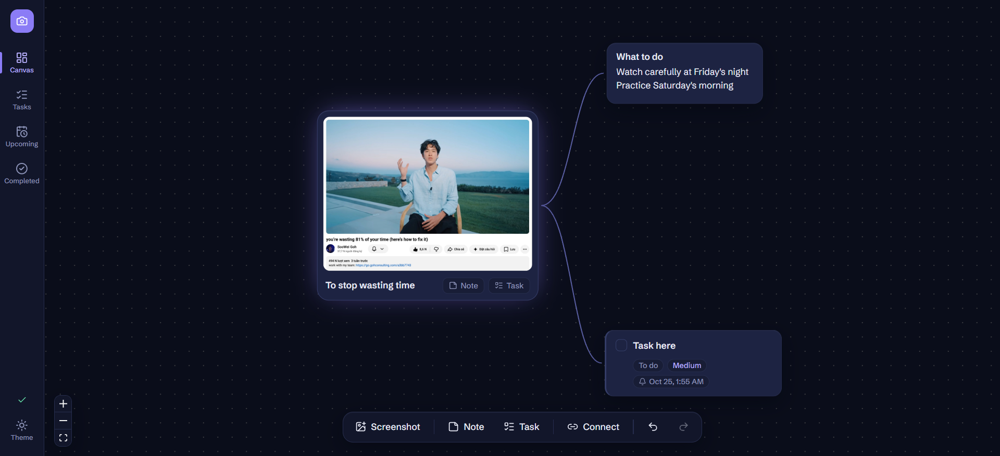
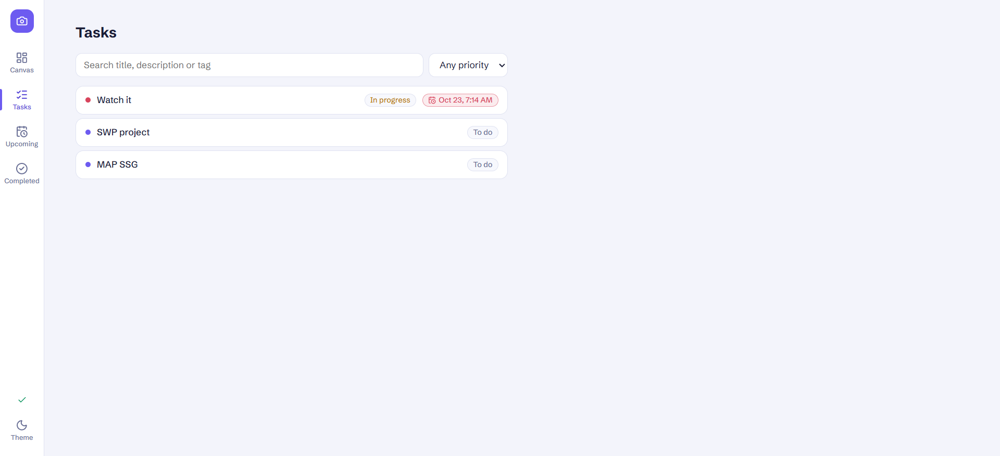
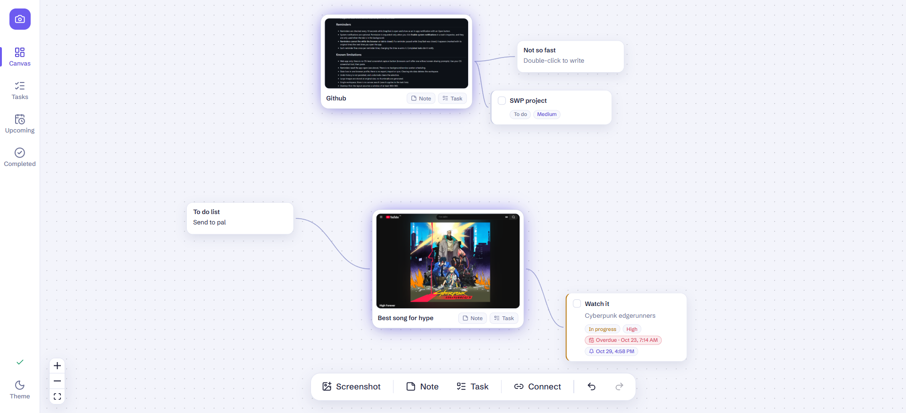

# SnapTask

A screenshot-centered visual task manager. **Capture first, organize later**: paste or drop a screenshot onto an infinite canvas, then branch notes and tasks off it and connect them however makes sense — no folders or projects required.

## Features

- **Infinite canvas** (React Flow): pan, zoom, drag, multi-select (Shift-drag a box), connect, reconnect, delete.
- **Screenshots**: paste with Ctrl+V, drop an image file onto the canvas, or import a file. Click the expand icon on a screenshot for a larger preview.
- **Notes**: double-click to edit inline; text autosaves; long notes expand and collapse.
- **Tasks**: title, description, status (To do / In progress / Done), priority, deadline, reminder, tags, completion checkbox, overdue indicator. Detailed editing in the right-hand inspector.
- **Lists**: Tasks, Upcoming (tasks with deadlines, soonest first) and Completed, with search and priority filter. Selecting a row jumps to that node on the canvas.
- **Undo/redo** for creating, deleting, moving, connecting, reconnecting and editing.
- **Reminders** shown in-app while SnapTask is open, plus optional system notifications.
- **Dark and light themes**, toast feedback, and an error boundary.

## Tech stack

React 18+, TypeScript (strict), Vite, @xyflow/react, Zustand, Lucide React. IndexedDB for storage. Vitest (+ jsdom, fake-indexeddb) for tests.

## Setup

```bash
npm install
npm run dev        # development server
npm run build      # type-check + production build
npm test           # automated tests
npm run preview    # serve the production build
```

On Windows PowerShell, use `npm.cmd` in place of `npm` if script execution is restricted.

## Keyboard shortcuts

| Shortcut | Action |
| --- | --- |
| Ctrl+V | Paste an image from the clipboard (canvas view) |
| Delete / Backspace | Delete selected nodes or connections |
| Ctrl+Z | Undo |
| Ctrl+Shift+Z or Ctrl+Y | Redo |
| Esc | Leave a text field → close preview → cancel Connect → deselect (one step per press) |
| Shift-drag | Box-select |
| Double-click a note | Edit inline |

Shortcuts never fire while you are typing in an input, textarea or date field; Ctrl+Z then undoes the text instead (browser behavior). Mac users can use Cmd in place of Ctrl.

## Persistence

- The workspace (nodes, edges, positions, text, task fields, viewport, theme, announced reminders) is saved to **IndexedDB** about half a second after each change, and again when the tab is hidden or closed.
- **Screenshot images are stored as binary data in a separate IndexedDB store.** Nodes only hold an image id, so large screenshots don't slow canvas interactions or inflate the saved workspace.
- The sidebar shows save status. If a save fails, SnapTask keeps your work in memory, warns you once, and retries every few seconds.
- Stored data is validated on load. Damaged items are skipped and reported. If the whole record is unreadable, SnapTask starts empty but **keeps the old data under a `workspace-backup-*` key** instead of overwriting it.
- If IndexedDB is unavailable (some private-browsing modes), the app works but warns that nothing will be saved.
- Undo history is in-memory only and resets on refresh.
- Images no node references are cleaned up on the next load.

## Reminders

- Reminders are checked every 10 seconds while SnapTask is open and show as an in-app notification with an Open button.
- System notifications are optional. Permission is requested only when you click **Enable system notifications** in a task's inspector, and they are only used when the tab is in the background.
- **Reminders cannot fire while the browser or tab is closed.** If a reminder passed while SnapTask was closed, it appears (marked with its original time) the next time you open the app.
- Each reminder fires once per reminder time; changing the time re-arms it. Completed tasks don't notify.

## Known limitations

- Web app only: there is no OS-level screenshot capture button (browsers can't offer one without screen-sharing prompts). Use your OS screenshot tool, then paste.
- Reminders need the app open (see above). There is no background/service-worker scheduling.
- Data lives in one browser profile; there is no export, import or sync. Clearing site data deletes the workspace.
- Undo history is not persisted, and undo/redo clears the selection.
- Large images are stored at original size; no thumbnails are generated.
- Single workspace; there is no canvas search (search applies to the task lists).
- Desktop-first: the layout assumes a window of at least 900×560.

## Screenshots




